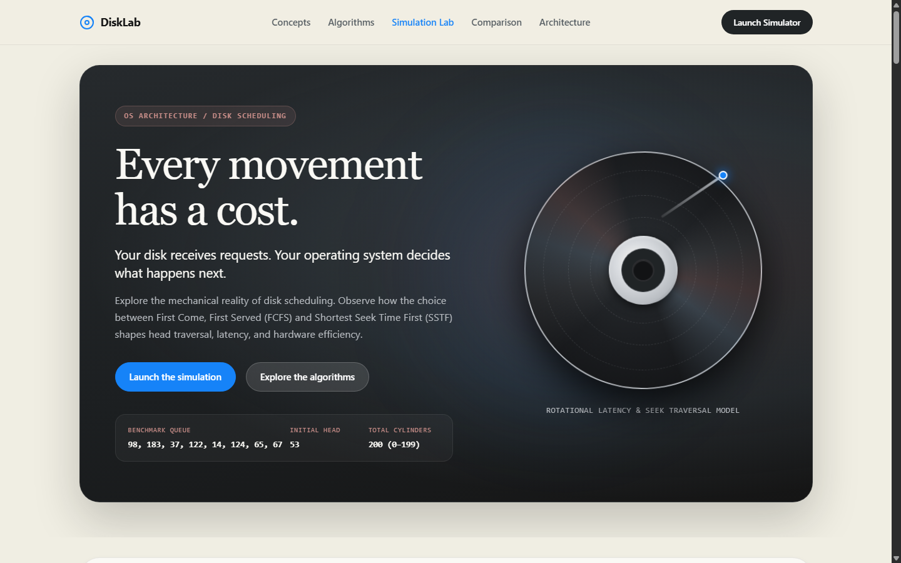

# DiskLab: Interactive Disk Scheduling Experience

> An Apple-inspired, cinematic, and technically rigorous educational web application for Operating Systems students exploring disk scheduling algorithms (**FCFS** and **SSTF**).



---

## 1. Overview & Conceptual Metaphor

DiskLab transforms the theoretical study of mechanical secondary storage into an interactive, visual journey. 

- **The Problem:** Modern operating systems receive asynchronous I/O requests scattered across non-contiguous disk cylinders. Naive ordering forces the physical actuator arm to traverse back and forth, accumulating severe mechanical seek latency.
- **The Platter Metaphor:** DiskLab centers around a realistic, dimensional circular platter (reminiscent of a CD or polished metallic HDD disk) with reflective anisotropic sheen, central spindle clamp, concentric cylinder tracks, and an optical/magnetic actuator head.
- **Physical vs. Optical Storage Nuance:** Real Hard Disk Drives (HDDs) employ multiple double-sided magnetic platters on a central spindle read by magnetic heads floating on air bearings. Compact Discs (CDs) are single-track optical spiral media read by lasers. DiskLab uses the circular platter as a visual model while accurately teaching logical cylinder scheduling.

---

## 2. Project Architecture & Modular Design

DiskLab is built with modern, zero-dependency **HTML5, CSS3, and Vanilla JavaScript**. It runs entirely locally in any browser with no server, database, or API keys required.

```
disklab/
├── index.html                   # Semantic markup (Sections A through G)
├── styles.css                   # Editorial styling, Apple-inspired aesthetics, responsive CSS
├── validation.js                # Strict input parsing and edge case validation
├── algorithms.js                # Pure, non-mutating FCFS and SSTF implementations
├── metrics.js                   # Performance calculations, comparisons, and statistics
├── visualization.js             # SVG platter renderer, track mapping, and animation engine
├── app.js                       # Master controller, state management, and event orchestration
├── tests/
│   ├── test_runner.js           # Headless Node.js unit tests (43 test assertions)
│   ├── dom_integration_test.js  # Static DOM and markup integrity tests (84 assertions)
│   └── chrome_headless_verify.py# Automated headless Chrome integration verifier
└── README.md                    # Project documentation, execution guide, and test logs
```

### Module Responsibilities

1. **`validation.js`**:
   - Validates disk size ($> 0$), starting head position ($0 \le \text{head} < \text{diskSize}$), and request queue.
   - Rejects empty tokens (`53,,98`), negative numbers, decimals, non-numeric text, and out-of-range cylinders.
   - Gracefully flags and handles edge cases: single-cylinder disks, single-request queues, duplicate requests, and requests matching current head position.

2. **`algorithms.js`**:
   - **`runFCFS(initialHead, queue)`**: Processes requests in strict arrival order without mutating the input queue.
   - **`runSSTF(initialHead, queue)`**: Greedily selects the pending request minimizing $|current\_head - request|$. Breaks equal-distance ties deterministically by selecting earlier queue arrival.
   - Generates step-by-step history: from-cylinder, to-cylinder, seek distance, cumulative distance, remaining queue, and selection reasoning.

3. **`metrics.js`**:
   - Calculates total head movement in cylinders.
   - Calculates average movement per request ($\text{total} / N$).
   - Calculates percentage reduction in total movement:
     $$\text{Reduction} = \frac{\text{FCFS} - \text{SSTF}}{\text{FCFS}} \times 100\%$$
   - Handles zero-baseline movement without division-by-zero artifacts.

4. **`visualization.js`**:
   - Renders SVG circular disk platter with concentric cylinder tracks mapped linearly ($c \in [0, \text{diskSize} - 1] \mapsto r \in [100, 255]$).
   - Renders spindle hub, metallic sheen, interactive request markers, glowing seek paths, and moving actuator head carrier.
   - Supports stepping forward/backward, scrubber timeline dragging, pause/play, and variable animation speeds ($0.5\times$, $1\times$, $2\times$).
   - Fully respects `prefers-reduced-motion`.

5. **`app.js`**:
   - Manages state, presets, user inputs, live validation feedback, synchronized dual platters, and step inspector callouts.

---

## 3. Website Sections & Storytelling Flow

- **Section A: Cinematic Opening**:
  - Full-width hero: *"Every movement has a cost."*
  - Supporting copy: *"Your disk receives requests. Your operating system decides what happens next."*
  - Ambient rotating metallic platter and actuator head.
  - Quick action buttons to explore algorithms or jump straight to the simulator.

- **Section B: Explain the Problem Visually**:
  - Headline: *"The requests don't arrive in a convenient order."*
  - Interactive linear track seek demo illustrating mechanical seek accumulation.
  - Interactive cards for: Disk Cylinders, Initial Head Position, Request Queue, Disk-Head Movement, Scheduling Algorithm.
  - Model clarification callout distinguishing logical cylinder space from physical HDD geometry.

- **Section C: Meet the Algorithms**:
  - **FCFS Card**: *"First in. First served."* (Arrival order, fairness, mechanical thrashing cost).
  - **SSTF Card**: *"The nearest request gets served next."* (Proximity minimization, throughput gain, starvation risk).
  - Interactive *"How the algorithm decides"* candidate distance inspector.

- **Section D: The Interactive Simulation Lab**:
  - Two-column product configurator layout.
  - Inputs: Disk size, initial head, queue, algorithm mode (FCFS, SSTF, Compare Both).
  - Five preset scenarios: *Default Benchmark*, *High Dispersion*, *Clustered Locality*, *Starvation Risk*, *Near-Sequential Access*.
  - Large SVG platter with stepper, scrubber, playback speed toggles.
  - Step inspector detailing each mechanical transition.
  - Side-by-side performance comparison cards and collapsible step-by-step calculation table.

- **Section E: Understand the Difference**:
  - Live-updated editorial comparison table covering 8 dimensions.
  - Takeaway banner: *"One algorithm follows arrival order. The other follows proximity. Their performance depends on the request workload."*

- **Section F: Behind the Logic**:
  - Tabbed pseudocode for FCFS and SSTF matching the JavaScript implementation.
  - Deterministic pipeline diagram: $\text{Input} \to \text{Validation} \to \text{Algorithm} \to \text{Metrics} \to \text{Visualization}$.
  - Engineering commentary on why modularity matters.

- **Section G: Final Takeaway**:
  - Minimal closing section with glowing platter icon.
  - Headline: *"Scheduling is a decision about movement."*
  - Subhead: *"FCFS values arrival order. SSTF prioritizes proximity. Understanding the trade-off is the first step toward understanding storage performance."*
  - Quick action returning to the simulator.
  - Footer: *DiskLab · Operating Systems Self-Learning Activity · Traditional Disk Scheduling*.

---

## 4. How to Run the Website Locally

No build tools, compilation, or package installations are required!

### Option 1: Direct File Opening (Simplest)
Double-click `index.html` in your file manager, or open in any web browser:
```
file:///C:/Users/ashut/.gemini/antigravity/scratch/disklab/index.html
```

### Option 2: Local HTTP Server (Recommended)
Using Python:
```bash
cd disklab
python -m http.server 8000
```
Then navigate to `http://localhost:8000` in Chrome, Edge, Safari, or Firefox.

Using Node.js:
```bash
npx serve .
```

---

## 5. Verification Test Suite & Results

### 1. Benchmark Numerical Verification
Default input: `Disk Size = 200`, `Initial Head = 53`, `Queue = [98, 183, 37, 122, 14, 124, 65, 67]`

| Metric | FCFS | SSTF | Delta / Comparison |
| :--- | :--- | :--- | :--- |
| **Service Sequence** | `53 → 98 → 183 → 37 → 122 → 14 → 124 → 65 → 67` | `53 → 65 → 67 → 37 → 14 → 98 → 122 → 124 → 183` | SSTF seeks locally first |
| **Total Movement** | **640 cylinders** | **236 cylinders** | **404 cylinders saved** |
| **Average Movement** | **80.00 cyl/req** | **29.50 cyl/req** | **50.50 cyl/req saved** |
| **Movement Reduction** | Baseline ($0\%$) | **63.13% reduction** | SSTF Winner |

### 2. Automated Test Suite Outcomes

Run the headless test suite:
```bash
node tests/test_runner.js
```
**Outcome:** **43 / 43 tests passed (100%)**:
- Benchmark calculations matched to the exact integer and percentage.
- Deterministic SSTF tie-breaker verified (earlier queue arrival wins).
- Edge cases verified: duplicate requests (`[98, 98, 14]`), requests at starting head position (`[53, 70]`), single-request queues (`[80]`), one-cylinder disks (`[0]`), zero-baseline comparison without `NaN` or `Infinity`.
- Validation checks verified: negative numbers, decimals, non-integers, empty queues, out-of-range cylinders, and malformed strings (`53,,98`).

Run the DOM and static integration suite:
```bash
node tests/dom_integration_test.js
```
**Outcome:** **84 / 84 assertions passed (100%)**.

Run the Headless Chrome verification:
```bash
python tests/chrome_headless_verify.py
```
**Outcome:** Headless Chrome loaded `index.html`, executed all JavaScript, generated dynamic SVG tracks and nodes, computed live metrics, and rendered 115,851 characters of rendered DOM without errors.

---

## 6. Accessibility & Responsiveness

- **Semantic HTML5:** Built using `<header>`, `<main>`, `<section>`, `<article>`, `<nav>`, `<form>`, `<fieldset>`.
- **Keyboard Navigation:** Every control, slider, button, and node supports standard keyboard focus and activation (`Enter`, `Space`, Tab, Shift+Tab).
- **Visible Focus States:** High-contrast `3px solid #0071e3` outline rings with offset on all interactive elements.
- **Screen Reader Support:** ARIA live regions for errors, warning banners, and step inspection badges.
- **Reduced Motion:** Fully complies with `@media (prefers-reduced-motion: reduce)`, disabling all ambient spin animations and replacing smooth seeks with instantaneous steps.
- **Responsive Layout:** Editorial two-column desktop configurator transitions into stacked single-column layout on tablet and mobile widths.
